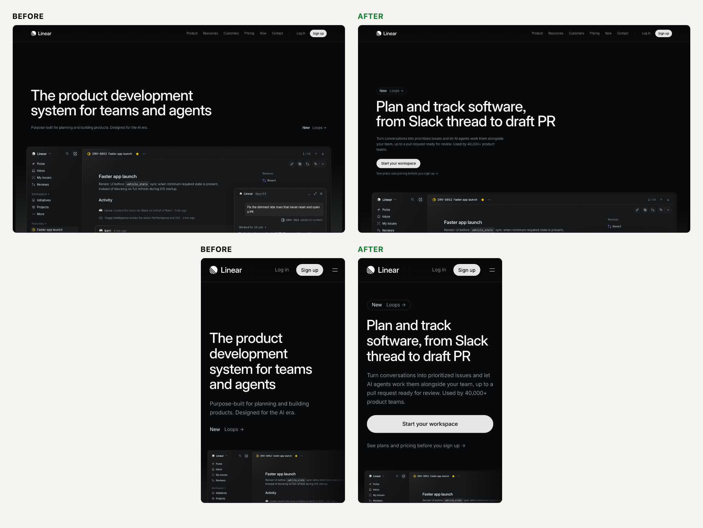

# Landing panel: https://linear.app

**3 of 7 stayed.** 4 left, 2 of them before scrolling past the hero.

| Visitor | Verdict | Stopped at | Seconds | In their words |
|---|---|---|---|---|
| The 3-second scroller | LEFT | first screen | 3 | ok it's software for 'teams and agents'... what does it do tho? swiping back. |
| The skeptical buyer who's been burned | LEFT | end of page | 90 | Good demo, real names, but not one word on price or what 'Get started' costs me. |
| The designer | STAYED | end of page | 95 | The craft sells it before the copy does. I'd sign up, though the hero never asks me to. |
| The copywriter | LEFT | end of page | 150 | Clear on what it is, silent on why it beats what I use, and the hero button goes to a changelog. |
| The competitor | STAYED | end of page | 150 | Their words are generic, their demo and logo wall aren't. I can copy the copy, not the proof. |
| The ideal customer | STAYED | end of page | 150 | That demo is my actual week. I'm signing up, but tell me what it costs first. |
| The mobile user on a slow phone | LEFT | first screen | 10 | Ten seconds in I'm still squinting at a blurry headline. Sign up for what? I'm out. |

## Why each one decided

### The 3-second scroller: left
_Some dark-mode software for tech teams, looks slick but I can't tell what it actually does for me._

- Biggest text is "The product development system for teams and agents". That's four buzzwords, not a thing I do. Is it a to-do app? Is it for coders? No idea in 3 seconds.
- Subhead "Purpose-built for planning and building products. Designed for the AI era." doesn't help. "AI era" is what every app says now.
- There's no button in the middle of the screen. The only thing to tap is the small "Sign up" up in the corner, and "New Loops →" means nothing to me.
- Roughly the top 300px under the nav is just empty black, so the app screenshot (the only thing that shows me what it is) is cut off at the bottom of the screen.

Would have changed it: A headline that says in normal words what it does and who it's for, like "Track every bug and feature your team ships", with the app screenshot pulled up so I see it right away.

### The skeptical buyer who's been burned: left
_A polished issue tracker with an AI agent bolted on, showing me a real-looking product screen instead of a stock illustration._

- Nothing on the page says what it costs or whether there's a free plan. 'Pricing' is a small nav link, and both buttons, 'Sign up' and 'Get started', never say free, no card, or cancel anytime.
- The copy sells with adjectives I've heard before: 'A new species of product tool', 'Linear sets a new standard', 'Built for the future'. Nothing in those lines shows me anything.
- The proof is better than most. Two quotes come with full names and titles (Gabriel Peal, Staff Software Engineer, OpenAI; Nik Koblov, Head of Engineering, Ramp), and the changelog is dated through OCT 22, 2026, so the product is clearly still being worked on. But the quotes are about feelings ('craft that using Linear infuses on your brain'), not results, and '40,000 product teams' is a number I can't check.
- The logo strip (OpenAI, Vercel, Salesforce, Figma, Cursor, coinbase, ramp) sits under 'POWERING THE COMPANIES BUILDING THE FUTURE' with no context: a whole company, one team, or one person?

Would have changed it: One line under the hero and final buttons saying what the free plan includes, that no card is needed, and the paid price per seat.

### The designer: stayed
_A disciplined dark product page where the real app UI is the hero image, not some gradient blob, and it looks like a tool made by people who sweat details._

- The fold shows the actual product: a full issue view for 'DRV-8852 Faster app launch' with an agent panel ('Linear Opus 5.5', 'Changed 2 files +22 -10', 'Draft Reset dimmed ride rows'). It's real interface with real-looking content, crisp at 1x, and it proves the product is polished better than any claim could.
- The type system is tight: two fonts only (Inter Variable plus Berkeley Mono for 'FIG 0.1' labels, dates and code), a confident 64px headline, and every section uses the same 'Intake / and integrations' left title with body on the right. The rhythm holds across all four feature sections.
- The hero has no clear focal action. The only button-like thing next to the 64px headline is 'New Loops ->', a 15px grey link pushed to the far right edge, level with a 15px grey subhead. The real 'Sign up' is a small pill in the nav, and the first proper 'Get started' button only shows up at the very bottom under 'Built for the future. Available today.'
- The middle sinks into near-black. The 'Planning and monitoring' roadmap and 'Cycle time by agent' chart in desktop_tile3 and the agent panels in desktop_tile4 fade to almost nothing, so whole screens read as empty dark rectangles. Then the testimonial cards jump to a pastel blue and a loud acid yellow that belong to a different brand.

Would have changed it: A solid 'Get started' pill placed directly under the subhead, so the hero's eye path ends on one action instead of a grey 'New Loops' link.

### The copywriter: left
_An issue tracker that wants to be called a 'product development system', and the screenshot under the headline does more selling than the headline._

- The headline 'The product development system for teams and agents' names a category and an audience but gives no reason it's better. The subhead 'Purpose-built for planning and building products. Designed for the AI era.' is two slogans that would fit any SaaS tool launched this year.
- The only link in the hero copy is 'New Loops →', which goes to an announcement post. Doing something means finding 'Sign up' in the nav. The one real call to action, 'Get started', sits at the very bottom under 'Built for the future. Available today.', which is filler.
- The best line on the page is buried: 'Linear powers over 40,000 product teams. From ambitious startups to major enterprises.' appears after the changelog, near the footer. Up top I get 'POWERING THE COMPANIES BUILDING THE FUTURE' and 'A new species of product tool... sets a new standard', which are claims with nothing behind them.
- The section headings are filing labels, not reasons to keep reading: 'Intake and integrations', 'Planning and monitoring', 'AI and automations', 'Build, review, and ship'. The concrete copy is stuck inside the mockups, e.g. 'Right now we show a spinner forever, which makes it look like the car disappeared...' and '@Linear can you take a stab at this?' -> 'Draft PR awaiting your review'. That story is the pitch, and no headline says it.

Would have changed it: A subhead that says what changes for me, like going from a Slack thread to a reviewed PR without retyping anything, plus a hero button that says what I get when I click.

### The competitor: stayed
_Another 'system for teams and agents' tracker headline, but the product shot under it is doing real work: a Slack thread turning into an issue and an agent opening a draft PR._

- The copy is pure category. 'Purpose-built for planning and building products. Designed for the AI era.', 'Designed for speed', 'A new species of product tool' and 'Built for the future. Available today.' could all go on my page tomorrow with nothing changed.
- The hero screenshot is the real wedge, and I can't fake it: 'Linear created the issue via Slack on behalf of Karri', then '@Linear can you take a stab at this?', then 'Pushed and opened a draft PR... Changed 2 files +22 -10'. That's the whole loop from a chat message to a PR, all inside the tracker. A buyer comparing us sees that working, not just a promise.
- The proof is hard to match. OpenAI, Vercel, Salesforce, Figma, Cursor, Coinbase and Ramp right under the hero, 'Linear powers over 40,000 product teams', and named quotes from a Staff Engineer at OpenAI and the Head of Engineering at Ramp. Most of us can't put up that logo row.
- The changelog strip ('Stacked pull requests' OCT 8, 'Slack and GitHub loop triggers' OCT 22, 2026) shows they ship every two weeks. That's where I'd attack: the page never gives a price, a setup time or a migration story near the hero, so I'd say 'what does it cost to switch, and how long does it take?'

Would have changed it: Already staying. What would really lock in the side-by-side is a headline that says what the demo shows (an issue becomes a reviewed PR without leaving the tracker) instead of a category label I can copy.

### The ideal customer: stayed
_An issue tracker and planning tool for software product teams who want AI agents doing real work in it. I read that as me: engineering lead at a 40-person startup, team on Jira and Slack, already pasting tickets into Cursor and Claude by hand. The page made me guess the team size, because it never says._

- The hero mockup in desktop_fold.png shows my exact problem: 'Right now we show a spinner forever', then '@Linear can you take a stab at this?', then 'Draft PR awaiting your review'. That's a bug going from a Slack complaint to a PR without me copying it anywhere. That's what I want.
- The Intake section (desktop_tile2.jpg) shows a Slack #product thread where the team grumbles about iOS startup, then '@Linear create issues and assign to me'. Today I do that by hand every morning.
- Proof works for someone like me: logos for OpenAI, Vercel, Cursor and Ramp under the hero, a Head of Engineering at Ramp quoted saying 'Linear helps us be action biased', and 'over 40,000 product teams'. Teams like mine use it.
- The next step isn't as low-risk as it should be. The only button near the hero is the small 'Sign up' in the nav. The big 'Get started' is at the very bottom, and nowhere does the page say free, trial or price. I have to click 'Pricing' to find out if I can try it with my team today.

Would have changed it: Already staying. What locks it in is a 'Get started free' button under the subhead with one line saying what's free and how long it takes to bring my Jira backlog over.

### The mobile user on a slow phone: left
_A black screen with the Linear logo and a Sign up button, and nothing telling me what Linear is._

- One second: logo, 'Log in', 'Sign up' and a black void. First paint at 1.7s was just the nav bar, so I had a button but no idea what it was for.
- Three seconds: the phone was too busy to paint anything new, so there's no frame at all. Still the same empty black screen.
- Six seconds: the headline 'The product development system for teams and agents' is there but blurred like it's behind frosted glass, and I can't read the subhead under it. At ten seconds it's still soft. The largest paint lands at 11.9s and load at 12.8s, after pulling 2,305 KB on my connection.
- Once it fully loads it reads fine with one thumb: big 38px headline, no sideways scrolling. But the only button in the hero is 'New Loops →', a 93x24 text link to an announcement, and the page counts 58 small tap targets.

Would have changed it: Show the headline and subhead as plain, sharp text in the first second, with no blur-in animation and no waiting on the 2.3 MB of app screenshots.

## What most visitors want fixed (counted by tag)

- **cta**: 6 of 7 (scroller, burned-buyer, designer, copywriter, ideal-customer, slow-phone)
- **headline**: 3 of 7 (scroller, copywriter, competitor)
- **mobile**: 3 of 7 (scroller, designer, slow-phone)
- **pricing**: 3 of 7 (burned-buyer, competitor, ideal-customer)
- **subhead**: 2 of 7 (copywriter, ideal-customer)
- **proof**: 1 of 7 (burned-buyer)
- **speed**: 1 of 7 (slow-phone)
- **visual**: 1 of 7 (designer)
- **differentiation**: 1 of 7 (competitor)

## The three fixes

1. **Put a real primary button ('Start your workspace', linking to /signup, styled like the light 'Sign up' pill, 44px tall on mobile) directly under the subhead, left-aligned with the headline, with a one-line 'See plans and pricing' link to /pricing beneath it. Demote 'New Loops →' to a small badge above the headline.** (cta; backed by scroller, burned-buyer, designer, copywriter, ideal-customer, slow-phone). Six of seven found no action in the hero: the only hero link goes to a Loops announcement, 'Sign up' is a small nav pill, and 'Get started' only appears at the very bottom.
2. **Replace the category label with what the demo under it shows: 'Plan and track software, from Slack thread to draft PR'. Then rename the four feature heads as outcomes in the same plain voice (e.g. 'Intake and integrations' -> 'Conversations become routed, prioritized issues').** (headline; backed by scroller, copywriter, competitor). The scroller couldn't tell what it does in 3 seconds, the copywriter and competitor both said the words are generic category copy while the Slack-to-PR demo is the real pitch.
3. **On mobile, cut the empty black band above the headline, drop the h1 to about 32px so it wraps in 3 lines, render the headline and subhead sharp at first paint (no blur/fade-in), and give hero links a 44px tap height so the product screenshot starts on the first screen.** (mobile; backed by scroller, designer, slow-phone). The phone fold is mostly empty black plus a 4-line headline, the slow phone saw a blurred headline for 10+ seconds, and the only hero tap target is a 93x24 text link.

## The rewrite

| | Before | After |
|---|---|---|
| Headline | The product development system for teams and agents The product development system for teams and agents | Plan and track software, from Slack thread to draft PR |
| Subhead | Purpose-built for planning and building products. Designed for the AI era. | Turn conversations into prioritized issues and let AI agents work them alongside your team, up to a pull request ready for review. Used by 40,000+ product teams. |
| Button | New Loops → | Start your workspace |

Under the button: See plans and pricing before you sign up →

### Section order

1. Hero (new headline, subhead, button) + the DRV-8852 product demo: The demo is what every visitor praised; the copy now names what it shows and the hero finally asks for the click.
2. Logo strip, with 'Linear powers over 40,000 product teams. From ambitious startups to major enterprises.' moved up from the customers block as its caption: Replaces 'POWERING THE COMPANIES BUILDING THE FUTURE' with the page's strongest checkable-sounding line, which the copywriter found buried near the footer.
3. Intake and integrations: Starts the loop the headline promises: the Slack #product thread becoming issues is the ideal customer's 'every morning' task.
4. AI and automations: The agents-as-teammates section is the differentiator the competitor can't copy; it belongs right after intake.
5. Build, review, and ship: Closes the Slack-thread-to-PR loop with the diff and review view.
6. Planning and monitoring: Roadmaps and cycle time matter to leads but don't advance the headline's story; also needs the contrast fix the designer flagged.
7. Customers (#customers): Gabriel Peal (OpenAI) and Nik Koblov (Ramp) quotes: Named proof right before the ask. [NEEDS: one quote with a measurable outcome, e.g. time to ship or tool replaced, with name and company]
8. [NEEDS: plan and pricing summary: what is free, whether a card is required, paid price per seat, and how long importing from Jira takes]: Pricing was the top unanswered question for the burned buyer, the competitor and the ideal customer; only the owner can state these terms.
9. Built for the future. Available today. (Get started / Contact sales): Keep the final ask, but repeat the hero button text and the pricing line under it instead of a slogan-only block.
10. Changelog (Loops triggers, stacked PRs, coding agent controls, Loops for PM): Dated shipping cadence reassures skeptics; it works as a closing trust signal rather than interrupting the pitch mid-page.
11. A new species of product tool (FIG 0.1 Purpose-built / 0.2 Powered by agents / 0.3 Designed for speed): Cut as a standalone section: three adjectives a rival can paste. Fold the one concrete line, 'From drafting PRDs to pushing PRs', into the AI and automations intro.

### Needs from the owner

- Free plan or trial terms (what is free, team size limit, whether a credit card is required) and the paid price per seat, for a line under the hero and final buttons
- How long switching takes, e.g. importing from Jira, if the owner can state it truthfully
- One customer quote with a measurable result (time saved, cycle time, tool replaced), with name, title and company
- One line per logo on which team uses Linear and for what, if the logo strip is to carry context
- Engineering change: remove the blur/fade-in on the hero text and lazy-load the 2,305 KB of product mockups so the headline is sharp at first paint on slow phones

